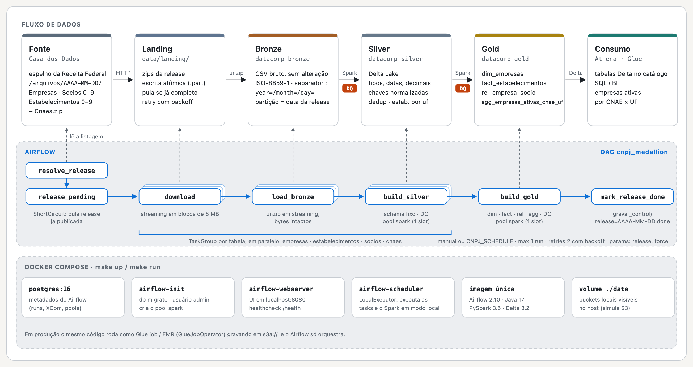

# CNPJ Medallion Pipeline

[](https://github.com/GabbyFranck/cnpj-medallion-pipeline/actions/workflows/ci.yml)

Pipeline containerizado que baixa os **Dados Abertos de CNPJ da Receita Federal** (espelho da
[Casa dos Dados](https://dados-abertos-rf-cnpj.casadosdados.com.br/arquivos/)) e os leva pelas
camadas **Bronze → Silver → Gold** com **Apache Airflow**, **PySpark** e **Delta Lake**, respondendo
à pergunta de negócio:

> **Qual a distribuição de empresas ativas por CNAE em cada estado?**

---

## Sumário

1. [Como executar](#como-executar)
2. [Arquitetura](#arquitetura)
3. [Camadas e modelo de dados](#camadas-e-modelo-de-dados)
4. [Qualidade de dados](#qualidade-de-dados)
5. [Decisões arquiteturais](#decisões-arquiteturais)
6. [Escalabilidade](#escalabilidade)
7. [Testes e lint](#testes-e-lint)
8. [Configuração](#configuração)
9. [Estrutura do repositório](#estrutura-do-repositório)
10. [Limitações e próximos passos](#limitações-e-próximos-passos)

---

## Como executar

**Pré-requisitos:** Docker (com Compose v2), `make`, ~4 GB de RAM livres para o Docker e ~3 GB de
disco para a carga padrão.

```bash
make up      # cria .env, builda a imagem e sobe Postgres + Airflow (http://localhost:8080, admin/admin)
make run     # despausa e dispara a DAG para a release mais recente
```

Acompanhe a execução na UI do Airflow (DAG `cnpj_medallion`). Os dados aparecem em `./data`:

```
data/
├── landing/2026-10-13/Empresas1.zip ...           # zips baixados (cache de download)
└── lake/
    ├── datacorp-bronze/empresas/year=2026/month=10/day=13/empresas_20261013_1.csv
    ├── datacorp-silver/empresas/_delta_log/ + part-*.parquet
    └── datacorp-gold/agg_empresas_ativas_cnae_uf/_delta_log/ + part-*.parquet
```

Outros comandos (`make help` lista todos):

| Comando | O que faz |
|---|---|
| `make run-release RELEASE=2026-09-14` | Processa uma release específica (`FORCE=true` reprocessa) |
| `make test` | Roda os testes dentro da imagem do Airflow |
| `make lint` / `make format` | flake8 + black (check / aplicar) |
| `make logs` | Logs do scheduler |
| `make down` / `make clean` | Para os containers / apaga containers, volumes e o lake |
| `make venv && make test-local` | Testes fora do Docker (requer Python 3.9+ e Java 11/17) |

> **Volume:** por padrão (`CNPJ_FILE_PARTS=1`) a DAG ingere **1 de 10 arquivos** de cada tabela
> (~450 MB de zips, ~4,5 M empresas e ~4,7 M estabelecimentos). Para a base completa
> (~7 GB zipados, dezenas de milhões de linhas por tabela) use `CNPJ_FILE_PARTS=all` no `.env`
> e dê mais memória ao Spark (`SPARK_DRIVER_MEMORY`).

---

## Arquitetura



> Versão completa em HTML, com as camadas, as checagens de DQ e o mapeamento local → AWS:
> [`docs/architecture.html`](docs/architecture.html) (abra o arquivo no navegador).

A DAG cria um **TaskGroup por tabela** (`empresas`, `estabelecimentos`, `socios`, `cnaes`), cada
um com `download → load_bronze → build_silver`. Os downloads rodam em paralelo; as tarefas Spark
usam o pool `spark` (1 slot por padrão) para não subir várias JVMs disputando a mesma memória.

| Task | Responsabilidade |
|---|---|
| `resolve_release` | Lê a listagem do espelho e escolhe a release (param da DAG > `CNPJ_RELEASE` > mais recente) |
| `release_pending` | `ShortCircuit`: pula a execução se a release já foi publicada (a menos que `force=true`) |
| `<tabela>.download` | Download em streaming, com retry/backoff, escrita atômica (`.part` → rename) e skip se já baixado |
| `<tabela>.load_bronze` | Descompacta em streaming para `bucket/tabela/year=/month=/day=/` sem alterar os bytes |
| `<tabela>.build_silver` | Lê o CSV bruto com schema fixo, tipa, limpa, deduplica, grava Delta e roda DQ |
| `build_gold` | Constrói `dim_empresas`, `fact_estabelecimentos`, `rel_empresa_socio` e o agregado; roda DQ |
| `mark_release_done` | Grava o marcador `_control/release=AAAA-MM-DD.done` |

---

## Camadas e modelo de dados

### Bronze (CSV bruto, particionado por data da release)

Cópia fiel dos arquivos da Receita: `;` como separador, aspas, **ISO-8859-1**, sem cabeçalho.
A partição `year=/month=/day=` é a **data da release**, não a data de execução, então reprocessar
uma release sobrescreve exatamente os mesmos arquivos (idempotência).

### Silver (Delta Lake)

| Tabela | Chave | Principais tratamentos |
|---|---|---|
| `empresas` | `cnpj_basico` | `capital_social` `1.234,56` → `decimal(18,2)`; porte → código + descrição |
| `estabelecimentos` (particionada por `uf`) | `cnpj` (14 dígitos) | CNPJ completo montado e com zeros à esquerda; `situacao_cadastral` + descrição + `is_ativo`; datas `yyyyMMdd` (`0`/`00000000`/inválidas → NULL); CNAEs secundários → `array<string>`; telefone com DDD; e-mail em minúsculas |
| `socios` | chave de negócio (empresa, tipo, nome, documento, qualificação) | tipo de sócio e faixa etária decodificados; CPF mantido mascarado como publicado |
| `cnaes` | `cnae` | tabela de domínio para rotular a Gold |

Comum a todas: trim e string vazia → NULL, chaves normalizadas, linhas sem chave descartadas,
deduplicação pela chave, colunas de linhagem (`_source_file`, `reference_date`, `ingested_at`).

### Gold (Delta Lake)

| Tabela | Grão | Conteúdo |
|---|---|---|
| `dim_empresas` | 1 linha por empresa | atributos da empresa + `qtd_estabelecimentos`, `qtd_estabelecimentos_ativos`, `qtd_socios`, `uf_matriz`, `is_ativa` |
| `fact_estabelecimentos` (particionada por `uf`) | 1 linha por estabelecimento | situação, CNAE principal + descrição, município/UF, atributos da empresa, ano de início |
| `rel_empresa_socio` | 1 linha por vínculo empresa ↔ sócio | tipo, qualificação, data de entrada, faixa etária |
| `agg_empresas_ativas_cnae_uf` | 1 linha por (UF, CNAE) | **resposta à pergunta de negócio**: `qtd_empresas_ativas` (distintas), `qtd_estabelecimentos_ativos`, `pct_empresas_ativas_uf`, `rank_cnae_uf` |

**Definição de "empresa ativa":** a situação cadastral é publicada por estabelecimento. Uma empresa
conta como ativa em um (UF, CNAE) se tiver ao menos um estabelecimento com situação `02 - ATIVA`
ali. Por isso o agregado traz as duas medidas: empresas distintas e estabelecimentos.

Exemplo de consulta (Spark SQL ou Athena, veja `sql/athena_gold_tables.sql`):

```sql
SELECT uf, rank_cnae_uf, cnae_fiscal_principal_descricao, qtd_empresas_ativas, pct_empresas_ativas_uf
FROM agg_empresas_ativas_cnae_uf
WHERE rank_cnae_uf <= 3
ORDER BY uf, rank_cnae_uf;
```

### Resultado real (release 2026-10-13, `CNPJ_FILE_PARTS=1`)

Execução de todas as tasks sobre **1 dos 10 arquivos** de cada tabela, baixados do espelho:

| Tabela | Linhas no Bronze | Linhas malformadas | Linhas no Silver |
|---|---:|---:|---:|
| empresas | 4.494.860 | 0 | 4.494.860 |
| estabelecimentos | 4.753.435 | 0 | 4.753.435 |
| socios | 2.019.150 | 0 | 2.019.117 (33 duplicatas removidas) |
| cnaes | 1.359 | 0 | 1.359 |

Gold: `dim_empresas` 4.494.860 · `fact_estabelecimentos` 4.753.435 (1.167.393 ativos) ·
`rel_empresa_socio` 2.019.117 · `agg_empresas_ativas_cnae_uf` 21.619 linhas (27 UFs + `EX`).

Top 3 CNAEs por empresas ativas em SP, RJ e MG:

| UF | # | CNAE | Descrição | Empresas ativas | Estab. ativos | % na UF |
|---|---:|---|---|---:|---:|---:|
| MG | 1 | 4781400 | Comércio varejista de artigos do vestuário e acessórios | 4.988 | 5.013 | 4,18% |
| MG | 2 | 9602501 | Cabeleireiros, manicure e pedicure | 4.981 | 4.981 | 4,17% |
| MG | 3 | 8112500 | Condomínios prediais | 4.246 | 4.246 | 3,55% |
| RJ | 1 | 9602501 | Cabeleireiros, manicure e pedicure | 4.318 | 4.319 | 4,58% |
| RJ | 2 | 8112500 | Condomínios prediais | 3.833 | 3.833 | 4,07% |
| RJ | 3 | 4781400 | Comércio varejista de artigos do vestuário e acessórios | 3.353 | 3.418 | 3,56% |
| SP | 1 | 0151201 | Criação de bovinos para corte | 12.371 | 12.687 | 3,41% |
| SP | 2 | 9602501 | Cabeleireiros, manicure e pedicure | 11.512 | 11.512 | 3,17% |
| SP | 3 | 4781400 | Comércio varejista de artigos do vestuário e acessórios | 10.881 | 11.019 | 3,00% |

> Os números refletem só o recorte de 1/10 da base (os arquivos da Receita são fatiados por
> faixa de CNPJ), então não representam a distribuição nacional. Com `CNPJ_FILE_PARTS=all` a
> mesma consulta responde a pergunta para a base completa.

---

## Qualidade de dados

Checagens leves (`src/cnpj_pipeline/quality/checks.py`) rodam **depois de cada escrita, lendo a
tabela Delta gravada**. Falhas `error` derrubam a task (e o Airflow faz retry/alerta); `warn` só
registra no log.

| Etapa | Checagem | Severidade |
|---|---|---|
| Bronze → Silver | % de linhas malformadas (nº de campos errado) ≤ `DQ_MAX_CORRUPT_RATIO` | error |
| Silver | tabela não vazia; chave não nula; chave única | error |
| Silver `estabelecimentos` | `uf` dentro das 27 UFs + `EX`; `situacao_cadastral` dentro do domínio | warn |
| Gold | todas as tabelas não vazias; unicidade em `dim_empresas` e `fact_estabelecimentos`; `uf`/CNAE não nulos no agregado | error |
| Gold | % de estabelecimentos sem empresa correspondente ≤ `DQ_MAX_ORPHAN_RATIO` | warn (cargas parciais geram órfãos por definição) |

As métricas de cada etapa (linhas no Bronze, malformadas, gravadas no Silver, descartadas) vão
para o log da task e para o XCom.

---

## Decisões arquiteturais

- **Airflow como orquestrador, com DAG fina.** A DAG só declara dependências; toda a lógica fica
  em `cnpj_pipeline.tasks`, que pode ser executado e testado fora do Airflow. Trocar
  `PythonOperator` por `GlueJobOperator`/`SparkSubmitOperator` em produção não muda nenhuma
  transformação.
- **PySpark + Delta Lake** (alinhado à stack Glue/S3/Athena). Os arquivos da Receita somam dezenas
  de GB descompactados; Spark processa em partições sem carregar tudo em memória, e a mesma
  sessão local roda em Glue/EMR. Delta traz escrita atômica (nunca expõe uma tabela pela metade),
  evolução de schema e *time travel*.
- **Snapshot completo com `overwrite` no Silver/Gold.** Cada release da Receita é a base
  **completa**, não um incremental. Sobrescrever é mais simples e correto que `MERGE`, e o
  histórico de releases continua consultável via `VERSION AS OF` no Delta.
- **Bronze imutável e fiel à fonte.** Nenhum parsing no Bronze: se uma regra do Silver estiver
  errada, basta reprocessar a partir do Bronze sem baixar nada de novo.
- **Schema explícito, tudo como string na leitura.** Os arquivos não têm cabeçalho; inferir
  schema seria lento e frágil. A tipagem acontece no Silver com funções pequenas e testáveis
  (`transform/parsing.py`), e linhas com nº de campos errado caem em `_corrupt_record` (contadas
  no DQ). O *column pruning* do parser CSV é desligado para que essa detecção seja consistente.
- **Idempotência ponta a ponta.** Download pula arquivos já completos (comparando o tamanho com o
  `Content-Length`); Bronze é particionado pela data da release; Silver/Gold sobrescrevem; um
  marcador evita reprocessar uma release já publicada (agenda semanal + `ShortCircuit`).
- **Estrutura que simula S3.** `data/lake/<bucket>/<tabela>/<particao>=<valor>` com buckets
  configuráveis. `LAKE_ROOT=s3` troca os caminhos Spark para `s3a://<bucket>/...`.
- **Configuração 100% por variáveis de ambiente** (`config.Settings`), sem valores fixos no código.
- **Pool Spark com 1 slot no ambiente local**, para não estourar memória com várias JVMs; os
  downloads continuam paralelos.

---

## Escalabilidade

| Hoje (local) | Em produção (AWS) |
|---|---|
| Spark `local[*]` dentro da task do Airflow | Mesmo código como **Glue job** / EMR Serverless (`GlueJobOperator`), Airflow só orquestra |
| Lake em pasta local | **S3** (`LAKE_ROOT=s3`) + Glue Data Catalog + **Athena** (DDL em `sql/`) |
| Download sequencial por tabela | Uma task mapeada por arquivo (*dynamic task mapping*) baixando direto para S3 |
| `LocalExecutor` | MWAA / `CeleryExecutor` / `KubernetesExecutor` |

Pontos que já favorecem escala:

- **Nada é carregado inteiro em memória fora do Spark**: download e unzip usam streaming em
  blocos (o `Estabelecimentos0.zip` tem >2 GB).
- **Particionamento** por `uf` em `estabelecimentos`/`fact_estabelecimentos`: as consultas por
  estado leem só a partição necessária (*partition pruning* no Spark e no Athena).
- **Broadcast join** da tabela de CNAEs (≈1.3 mil linhas) com a fato, evitando shuffle.
- O agregado é calculado **a partir da fato já persistida**, sem refazer joins.
- **Volume controlável** (`CNPJ_FILE_PARTS`) para desenvolvimento rápido com dados reais.
- Próximos passos para a base completa: `OPTIMIZE`/`ZORDER BY (cnae_fiscal_principal)` na fato,
  *auto compaction* no Delta e `spark.sql.shuffle.partitions` dimensionado pelo volume.

---

## Testes e lint

```bash
make test         # pytest dentro da imagem
make lint         # flake8 + black --check
```

- `tests/test_parsing.py`: parsers de data, decimal BR, CNPJ, códigos e CNAEs secundários.
- `tests/test_transforms.py`: regras de Silver (tipagem, deduplicação, chaves) e da Gold,
  incluindo o agregado de empresas ativas por CNAE/UF.
- `tests/test_quality.py`: cada checagem de DQ e a política error × warn.
- `tests/test_ingestion.py`: descoberta de releases, URLs, download (skip, arquivo truncado) e
  extração de zip, com uma sessão HTTP falsa, sem rede.
- `tests/test_pipeline_end_to_end.py`: zips no formato real da Receita (ISO-8859-1, acentos)
  passando por Bronze → Silver → Gold, mais o caso em que o DQ barra linhas malformadas.

Configuração: `.flake8` e `pyproject.toml` (black, linha de 100 colunas; pytest).

---

## Configuração

Todas as variáveis estão em `.env.example` (copiado para `.env` pelo `make up`).

| Variável | Padrão | Descrição |
|---|---|---|
| `CNPJ_BASE_URL` | espelho Casa dos Dados | Listagem com uma pasta por release |
| `CNPJ_RELEASE` | *(vazio = mais recente)* | Fixa uma release `AAAA-MM-DD` |
| `CNPJ_FILE_PARTS` | `1` | Arquivos numerados por tabela: `all`, `1`, `0-3`, `0,5` |
| `LAKE_ROOT` / `LANDING_DIR` | `data/lake`, `data/landing` | Raiz do lake (`s3` para usar `s3a://`) e cache de zips |
| `BRONZE_BUCKET` / `SILVER_BUCKET` / `GOLD_BUCKET` | `datacorp-*` | Nomes dos "buckets" |
| `SPARK_MASTER` / `SPARK_DRIVER_MEMORY` / `SPARK_SHUFFLE_PARTITIONS` | `local[*]`, `4g`, `64` | Dimensionamento do Spark |
| `DQ_MAX_CORRUPT_RATIO` / `DQ_MAX_ORPHAN_RATIO` | `0.001`, `0.05` | Limites de DQ |
| `SPARK_POOL` / `SPARK_POOL_SLOTS` | `spark`, `1` | Pool do Airflow para as tasks Spark |

---

## Estrutura do repositório

```
.
├── dags/cnpj_medallion_dag.py        # DAG (só orquestração)
├── src/cnpj_pipeline/
│   ├── config.py                     # Settings a partir de variáveis de ambiente
│   ├── storage.py                    # convenções de caminho bucket/tabela/particao=valor
│   ├── schemas.py                    # layouts da Receita e tabelas de códigos
│   ├── spark_session.py              # SparkSession com Delta
│   ├── tasks.py                      # entry points chamados pela DAG
│   ├── ingestion/                    # release.py, download.py, bronze.py
│   ├── transform/                    # parsing.py, silver.py, gold.py
│   └── quality/checks.py             # checagens de DQ
├── tests/                            # pytest (unitários + ponta a ponta)
├── sql/athena_gold_tables.sql        # registro das tabelas Gold no Athena
├── docker/airflow/Dockerfile         # Airflow 2.10 + Java 17 + PySpark 3.5 + Delta 3.2
├── docker-compose.yml
├── Makefile
└── .env.example, .flake8, pyproject.toml
```

---

## Limitações e próximos passos

- O Bronze é escrito com I/O local (pathlib). Para `LAKE_ROOT=s3` o passo de download/unzip
  precisaria gravar via `boto3`/`s3fs`; as camadas Spark já funcionam com `s3a://`.
- Com `CNPJ_FILE_PARTS` parcial, empresas, estabelecimentos e sócios vêm de recortes diferentes
  da base, então muitos estabelecimentos ficam sem empresa correspondente (por isso o DQ de
  órfãos é só `warn`). Com `all` o modelo fica completo.
- Outras tabelas de domínio (municípios, naturezas, qualificações, países) e o Simples Nacional
  podem ser adicionados só registrando um novo `EntitySpec`.
- Alertas (Slack/e-mail via `on_failure_callback`) e métricas de DQ persistidas numa tabela
  própria seriam o próximo passo de observabilidade.
